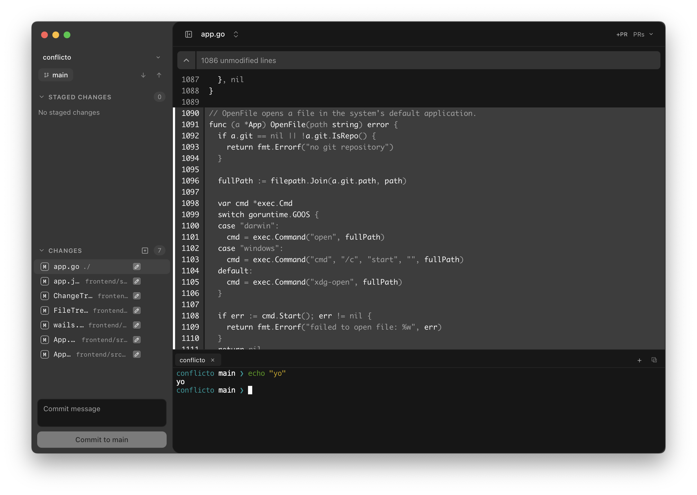

# conflicto

<p align="center">

</p>
<p align="center">
  <span>Small on purpose. Sharp on every diff.</span>
</p>

## Quick install (macOS)

[Nightly builds](https://github.com/barelyhuman/conflicto/releases) are **unsigned and unnotarized** — macOS will warn on first launch. Download `conflicto-macos-arm64.zip` (Apple Silicon) or `conflicto-macos-amd64.zip` (Intel), unzip to `/Applications`, then:

```bash
xattr -cr /Applications/conflicto.app   # remove quarantine
open /Applications/conflicto.app        # first launch: right-click → Open if macOS still blocks
```

Nightlies are tagged by date (`nightly-2026.09.01`) and only publish when `main` has new commits since the previous nightly. [Build from source](#build-from-source)

## Quick install (Linux)

Nightly Linux builds are unsigned AppImages: `conflicto-linux-x86_64.AppImage` (Intel/AMD) or `conflicto-linux-aarch64.AppImage` (ARM64). Download one, then:

```bash
chmod +x conflicto-linux-x86_64.AppImage
./conflicto-linux-x86_64.AppImage   # needs FUSE (fuse2); if unavailable: ./conflicto-linux-x86_64.AppImage --appimage-extract && ./squashfs-root/AppRun
```

Requires glibc 2.39+ (Ubuntu 24.04+, Debian 13+, Fedora 40+) and `webkit2gtk 4.1` at runtime — installed by default on those distros' desktop editions; on Debian/Ubuntu install it with `sudo apt install libwebkit2gtk-4.1-0`.

> [!WARNING]
>
> Alpha software, expects bugs

## Prerequisites

- **[mise](https://mise.jdx.dev/)** — Installs and runs the pinned Go, Node, and pnpm versions from `mise.toml`. See [Setup](#setup) below.
- **GitHub CLI (`gh`)** — [Install gh](https://cli.github.com/), then authenticate:

  ```bash
  gh auth login
  ```

  PR listing, checkout, comments, and related GitHub features call `gh` at runtime. Diff viewing still works without it; GitHub integration does not.

- **Git** — required for all repository operations.
- **ripgrep (`rg`)** *(optional)* — global search and the text-search fallback for code navigation. Without it, search falls back to `git grep`.
- **Language servers** *(optional)* — code intelligence per language. Only the active worktree's servers run. A missing one shows an install hint in the status pill:
  - Go: `gopls` (`go install golang.org/x/tools/gopls@latest`)
  - TypeScript / JavaScript: `typescript-language-server` (`npm i -g typescript-language-server typescript`)
  - Python: `pyright-langserver` (`npm i -g pyright`)
  - Rust: `rust-analyzer` (`rustup component add rust-analyzer`)

Also required to build: a C/C++ toolchain for [Wails](https://wails.io/) (platform deps vary — see the Wails docs).

## How it works

- **Workspaces are worktrees.** Each workspace is one git worktree: your main checkout or a PR's worktree. Switching workspaces switches the whole view, including tabs, terminals and language servers.
- **Navigate with the palette.** `⌘K` opens a fuzzy palette over repos, open PRs and worktrees. The home screen (`⌘⇧H`) shows the same index at full size. The index is backed by a local `gh` cache that refreshes in the background.
- **Opening a PR creates a worktree.** Checking out a PR creates a worktree for its branch and records the PR↔worktree mapping in the repo's git config. Worktrees whose PR is merged or closed are marked stale. Cleanup is manual.
- **Per-worktree terminals.** Each worktree keeps its own terminals across switches. `Cmd`+click on `file:line` in terminal output opens the file at that line.
- **Editor tabs.** The diff of a changed file and file tabs (CodeMirror) share one tab strip. You can edit files in place and save with `⌘S`.
- **Code intelligence.** Go to definition (`F12`, `⌘`+click), find references (`⇧F12`) and completion come from the language servers above. While a server is indexing, or when none is installed, navigation falls back to ripgrep text matching.
- **Global search.** `⌘⇧F` searches the active worktree. The selected text seeds the query.
- **Reviewing PRs.** Select lines and press `⌘⇧M` to comment; `⌘⇧V` attaches a pasted block to a file and line. Comments collect into a pending review that you submit in one batch.

Every shortcut is listed under **Preferences → Shortcuts** (`⌘,`).

## Setup

Install mise, then trust and install the project toolchain:

```bash
curl https://mise.run | sh          # or: brew install mise
cd conflicto
mise trust                            # allow tasks/env from mise.toml
mise install                          # Go, Node, pnpm (versions pinned in mise.toml)
mise run setup                        # sync icon, install deps, build frontend
```

After setup, `mise run dev` starts Wails dev mode with live reload.

## Build from source

```bash
git clone https://github.com/barelyhuman/conflicto.git
cd conflicto
mise trust
mise install
mise run build:frontend
mise run build
```

That syncs the app icon and runs `wails build`. The binary lands under `build/bin/`.

Useful tasks (run with `mise run <task>`):

| Task               | Description                                          |
| ------------------ | ---------------------------------------------------- |
| `dev`              | Wails dev mode (live reload)                         |
| `build`            | Local debug binary                                   |
| `build:production` | Production binary (`-ldflags="-w -s" -trimpath`)     |
| `test`             | Go + frontend tests                                  |
| `test:frontend`    | Frontend unit tests (Vitest)                         |
| `clean`            | Remove build artifacts                               |
| `setup`            | First-time setup (clean, icon, deps, frontend build) |

Frontend-only: `dev:frontend` / `build:frontend` (runs `pnpm` in `frontend/`). Vite alone has no Go backend — use `dev` for a working UI.

List all tasks: `mise tasks`

## Keybindings

The full, platform-specific list is in **Preferences → Shortcuts** (`Cmd/Ctrl+,`). The source of truth is `frontend/src/keymap/shortcuts.js`.

On macOS, the Edit menu also provides the usual text-editing shortcuts (`Cmd+A/C/V/X/Z`).
